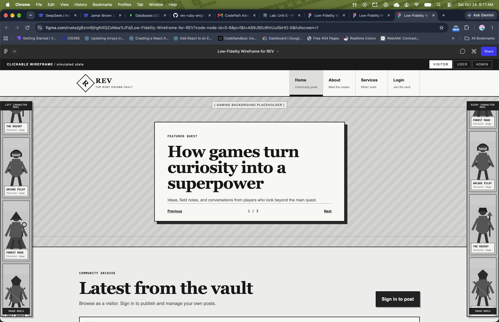
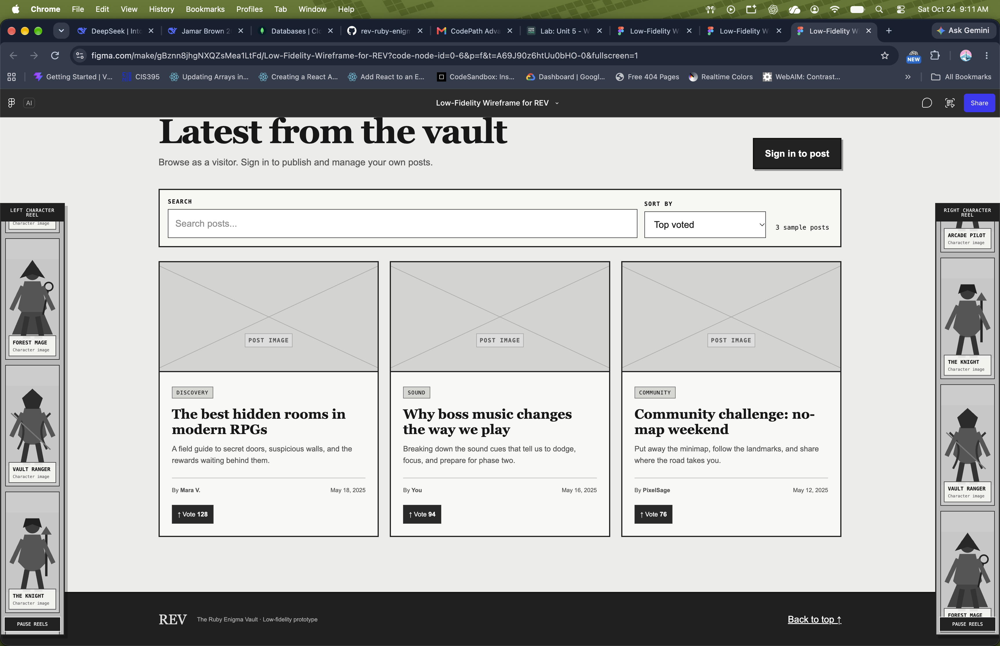
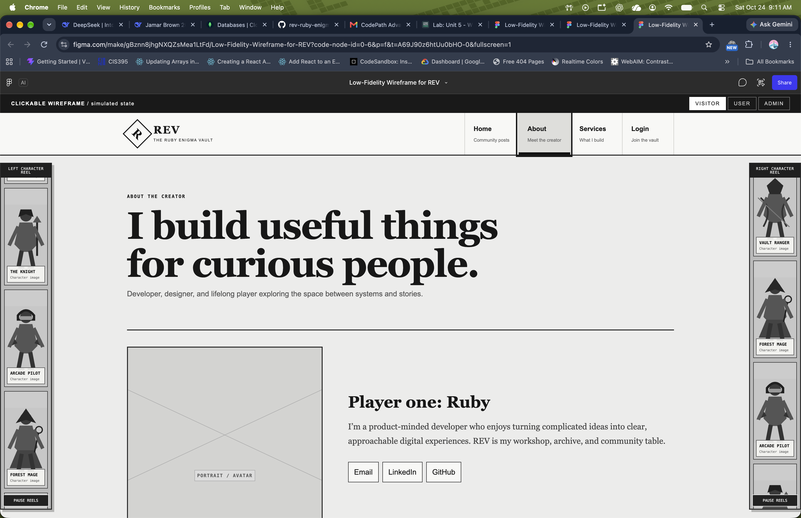
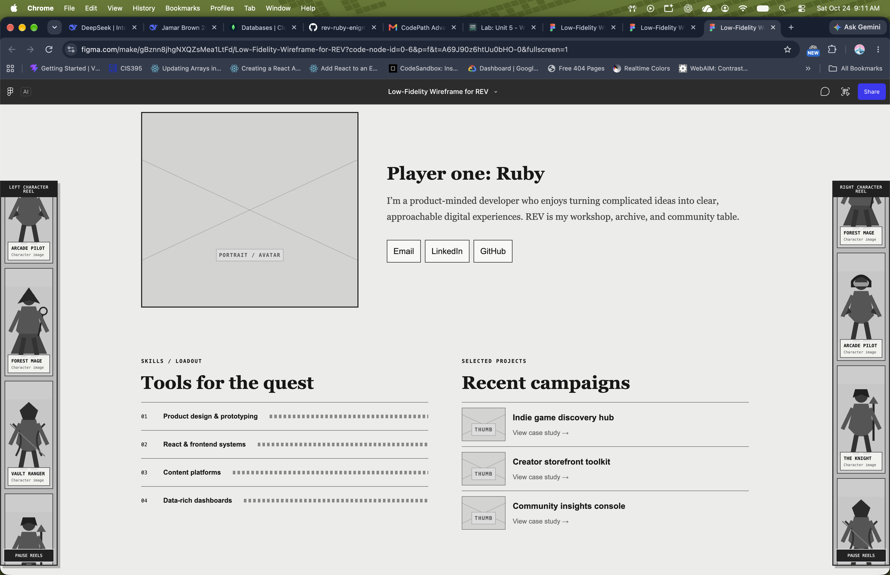
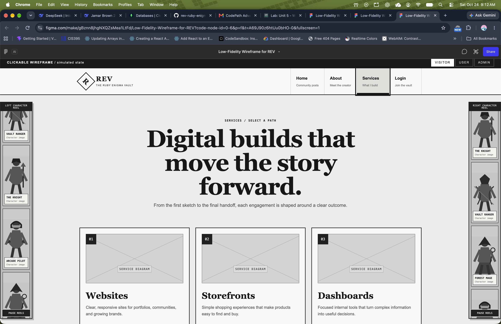
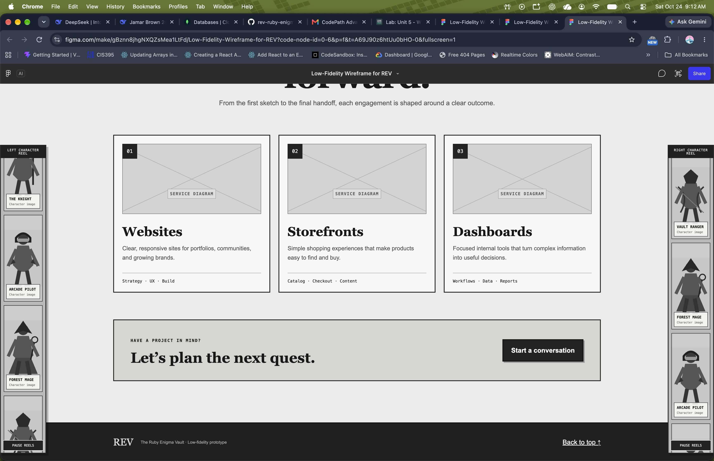
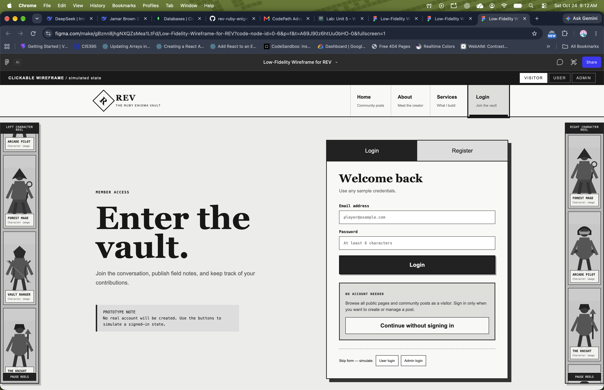
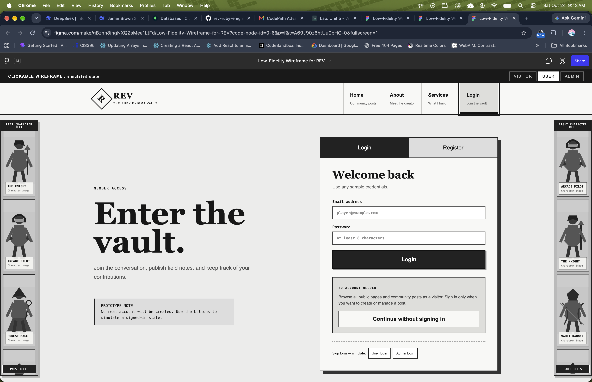
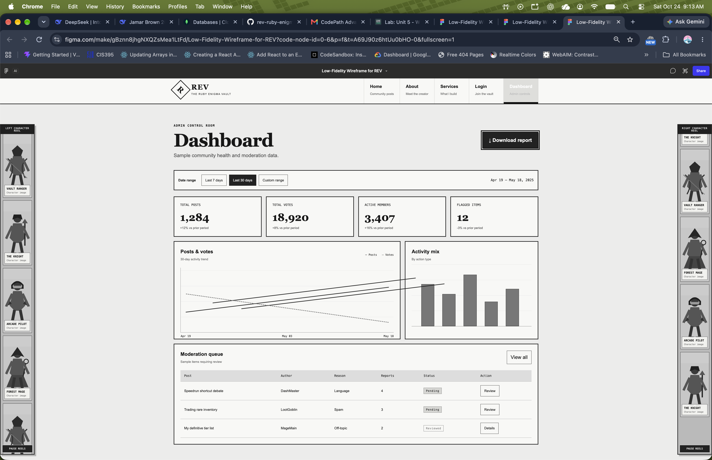

# REV — Wireframes and Interface Plan

Developer: Jamar Brown  
Design snapshot: October 24, 2026  
Source: nine screenshots saved in the [wireframes folder](wireframes/).

These low-fidelity screenshots document layout and intended interactions. Grayscale blocks, character illustrations, names, dates, counts, charts, and portfolio examples are placeholders, not final assets or live application data. Static screenshots do not verify animation or working backend features.

## Five Primary Pages

The paths below were the proposed frontend routes. All five are now built; see [What changed from the wireframes](#what-changed-from-the-wireframes) at the end.

| Page | Proposed route | Access | Screenshot coverage |
| --- | --- | --- | --- |
| Home / Community Posts | `/` | Public browsing | Hero and post grid |
| About | `/about` | Public | Introduction, skills, and projects |
| Services | `/services` | Public | Services overview and contact CTA |
| Login / Register | `/login` | Public entry to member access | Login panel; Register tab visible |
| Dashboard | `/dashboard` | Administrator only | Sample metrics, charts, and report control |

Post details and create/edit forms are supporting views, not extra primary navigation sections. The game catalog/detail experience from the broader feature plan still needs a placement decision and a dedicated layout; the saved Home images show community posts, not a finished game catalog.

## Shared Layout

- REV logo and a shared header with navigation subtitles: Home / Community posts, About / Meet the creator, Services / What I build, and Login / Join the vault.
- Dashboard navigation should appear only for an authenticated administrator. The API must independently enforce that restriction.
- A central content area framed by left and right gaming-character reels on wide screens.
- A gaming background behind readable content panels; these wireframes do not settle the final colors or typography.
- A consistent footer with a Back to top link.
- Intended React structure: a shared layout with a header, footer, and an Outlet for each page, plus reusable cards, forms, carousel controls, and feedback components.

The VISITOR / USER / ADMIN switcher and simulated-login shortcuts are prototype tools only. They must not become production controls that let a visitor select administrator privileges.

## 1. Home / Community Posts

### Layout and behavior

The top section contains a gaming-background placeholder and a central Featured Quest carousel. Previous/Next controls and slide indicators support manual browsing. Decorative character reels frame the page; the design intent is ongoing vertical movement with character changes around every 20–30 seconds, with pause controls. Final timing and motion need implementation testing.

The archive below contains a search input, sorting control, and a three-column post-card grid. Each card shows an image, category, title, excerpt, author, date, and reaction information. Selecting a post should open its dedicated detail view.

Visitors can read public content. Publishing, commenting, and voting require login. Although the mockup shows an up-vote button, the agreed application behavior is one like or dislike per signed-in account per post, enforced by the backend.

### Hero reference

### Post-grid reference

### Data and feedback

Posts come from the API, not hardcoded prototype cards. Search and sorting need defined behavior, loading indicators, an empty-results message, and recoverable request errors. Vote totals must come from saved votes; visible controls alone are not authorization.

## 2. About

### Layout and behavior

An introductory heading leads to a two-column portrait-and-biography section, followed by skills and selected projects. Email, LinkedIn, and GitHub controls provide contact paths.

The screenshot's “Player one: Ruby,” sample skill bars, and fictional project names are placeholders. Final copy should identify Jamar Brown and describe real skills and projects without invented proficiency scores or achievements. Portfolio project links should point to actual destinations.

### Introduction reference

### Skills and projects reference

### Data

Biography and service copy can initially be static content. Reusable project cards can display records from the projects collection when that API is connected.

## 3. Services

### Layout and behavior

A clear headline introduces three service cards: Websites, Storefronts, and Dashboards. Each card has a diagram/image placeholder, a short explanation, and an outcome-oriented description.

A lower call to action, “Start a conversation,” should lead to a real contact option. This page advertises intended services; it does not add a shopping cart, payment system, or Shopify integration to the initial build.

### Overview reference

### Contact reference

## 4. Login / Register

### Layout and behavior

The left side introduces member access. The right side contains a tabbed Login/Register panel, labeled email and password inputs, a submit button, and a “Continue without signing in” option.

The saved screenshots capture the Login panel twice, with different simulated roles. They do not show the registration form itself. The final registration state needs username, email, password, validation, and submission feedback consistent with the backend requirements.

### Visitor-state reference

### Simulated-user reference

### Production requirements

- Replace “Use any sample credentials” and sample password hints with accurate, backend-aligned instructions.
- Remove role-switching and “simulate user/admin login” controls.
- Submit credentials to the authentication API and use the server-established session.
- Do not store passwords or session identifiers in localStorage. Browser password-manager support is separate from application storage.
- Disable duplicate submissions and display errors inside the page.
- Provide logout and an appropriate signed-in navigation state.
- Design Forgot password and Reset password states separately. Do not imply email recovery is operational until delivery is configured and tested.
- Return the user to an appropriate safe destination after login; a regular user must not receive administrator access.

## 5. Administrator Dashboard

### Layout and behavior

The screenshot includes a Dashboard heading, Download report button, date-range controls, summary cards, a Posts & votes trend chart, an Activity mix chart, and a sample moderation table.

All dates, counts, percentages, and chart lines are mock data. Their presence does not mean analytics or report export already work.

### Data and scope decisions

- Require administrator authorization for the page, metrics endpoints, and report downloads.
- Compute summaries from existing users, posts, comments, votes, games, and categories. No dashboard collection is required just to display these records.
- Implement analytics after the core workflows, with Python calculations introduced incrementally.
- The initial dashboard can use verified totals, posts/reviews over time, games by platform/category, and review-rating summaries.
- Define each date filter and metric before coding it. “Active members” needs a stated definition; do not imply login-event tracking if it has not been implemented.
- “Flagged items,” reports, and the moderation queue are prototype ideas. The current model does not define a reporting/moderation workflow. Defer them or replace that area with a table derived from existing records rather than inventing data.
- Dashboard access does not automatically grant permission to edit another author's post. The current post rule is author-only editing/deletion.
- PDF export is planned functionality, not a completed screenshot feature. Show progress and an error message if generation fails.
- Include empty-data states and readable chart summaries or tables.

## Supporting Views to Refine

These are planned views; the supplied screenshots do not show their layouts.

| View | Proposed route or location | Essential behavior |
| --- | --- | --- |
| Post details | `/posts/:id` | Full post, author/date, review information when relevant, comments, and like/dislike controls |
| Create post | `/posts/new` | Signed-in form with review/discussion fields and validation |
| Edit post | `/posts/:id/edit` | Prefilled reusable form; server verifies author ownership |
| Delete confirmation | Inside the author's detail/edit view | In-app confirmation, pending state, and clear success/error feedback |
| Registration | Register state of the access panel | Account fields, validation, and no client-selected role |
| Password recovery | Dedicated access-panel states or routes | Generic request feedback and secure reset flow once delivery is configured |
| Game catalog/details | Placement to be finalized | Search/filtering and game information without confusing games with community posts |

Deleting a post must remove its related comments and votes through backend logic. Hiding an Edit/Delete button is helpful interface behavior, but it does not replace API authorization.

## Responsive and Accessibility Plan

The design starts with the desktop composition and adapts responsively; this does not require a mobile-first design process.

- Reduce or hide decorative side reels when space is limited; do not squeeze the central content.
- Reflow the three-column post/service grids into fewer columns and stack portrait/form sections on narrow screens.
- Use an accessible compact navigation menu where the full header no longer fits.
- Keep form text readable, controls easy to tap, and the page free of unintended horizontal scrolling.
- Provide visible focus styles, semantic headings, proper form labels, and keyboard-operable menus/carousels.
- Keep a Pause control for automatic motion and respect reduced-motion preferences.
- Give meaningful post/game images descriptive alternatives; purely decorative character art can use empty alt text.
- Verify final foreground/background colors rather than assuming the grayscale wireframe proves contrast.
- Save only non-sensitive preferences, such as light/dark mode, in localStorage.

Phone/tablet behavior is a plan, not something verified by these desktop screenshots.

## Remaining Design Work

Status as of November 15, 2026 (prototype complete, running locally).

- [x] Capture the five main page layouts.
- [x] Document all nine screenshots and their intended behavior.
- [x] Refine registration, post details, and create/edit form states. *(Built: `/login` with a Register tab, `/posts/:id`, `/posts/new`, `/posts/:id/edit`.)*
- [ ] Password recovery states. *(The server side is built and tested, but no email service sends the link, so the flow is not release-ready.)*
- [x] Decide game catalog placement. *(Its own page at `/games`, with `/games/:id` details.)*
- [x] Finalize dashboard metrics. *(Public sample dashboard at `/dashboard`; admin community dashboard at `/admin/dashboard`. Charts use sample data; the admin Newest posts table is live.)*
- [x] Replace fictional biography, projects, and sample text with Jamar's actual content. *(About page and `client/src/data/site.js`.)*
- [x] Choose final colors, fonts, and appropriately licensed assets. *(Dark/light ruby theme, self-hosted fonts, original AI-generated REV characters instead of copyrighted game art.)*
- [x] Compact navigation and narrow-screen layouts. *(Phone tab bar, Menu button, and layouts tested at 320–1440px.)*
- [x] Loading, empty, validation, error, confirmation, and success states. *(In-page messages, disabled buttons while saving, in-page delete confirmation, `role="status"` announcements.)*
- [x] Verify the implemented UI against these references. *(Browser QA reports in [qa-reports/](../../qa-reports/README.md).)*

### What changed from the wireframes

- The admin dashboard's "Download report" became the browser's Print / Save as PDF, with print styles. Python analytics were deferred.
- The flagged-items moderation queue was not built; the admin dashboard shows a live Newest posts table instead.
- The single up-vote became one like or dislike per signed-in account per post.
- The prototype-only VISITOR / USER / ADMIN switcher and "simulate login" buttons were not carried into the real app. Admin sign-in also needs a 6-digit authenticator code.
- Contact and Privacy pages were added. "Start a conversation" goes to a Google Calendar booking page and a Google Form.

Related planning: [User stories](user_stories.md) · [MongoDB ERD notes](entity_relationship_diagram.md) · [ERD image](REV_MongoDB_ERD.png).
