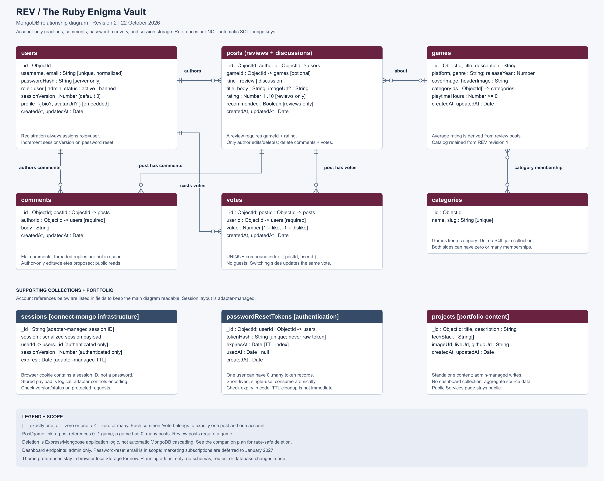

# REV — Entity Relationship Diagram

Revision 2 · 22 October 2026 · MongoDB + Mongoose planning document

REV (The Ruby Enigma Vault) combines a gaming community, portfolio, public services information, account authentication, and a private administration dashboard. This document describes the planned data model; it does not implement the database or certify that security features are complete.

## List of Collections (MongoDB Equivalent of Tables)

The course template says “tables,” but REV uses **collections** containing **documents**. Documents use `_id` identifiers, normally MongoDB `ObjectId` values. A reference stores another document's identifier; it is **not** an automatically enforced SQL foreign key.

| Collection | Purpose | Ownership / access |
| --- | --- | --- |
| `users` | Accounts, password hashes, roles, profile, and session-revocation version | Private account fields; backend-controlled roles |
| `posts` | Reviews and general discussions | Public reads; authenticated creation; author-only edits/deletes |
| `comments` | Flat comments attached to posts | Public reads; authenticated creation; author-only edits/deletes proposed |
| `votes` | One like or dislike per account per post | Authenticated users and admins only |
| `games` | Game catalog referenced by reviews | Public reads; admin-managed writes proposed |
| `categories` | Reusable game classifications | Public reads; admin-managed writes proposed |
| `projects` | Portfolio projects and links | Public reads; admin-managed writes |
| `passwordResetTokens` | Short-lived, single-use password-recovery records | Backend only; never returned in public APIs |
| `sessions` | Persistent login sessions managed by `express-session` + `connect-mongo` | Backend infrastructure; not a hand-written public CRUD model |

The game catalog and portfolio entities are retained from revision 1. They are not prerequisites for the first post CRUD implementation. Reviews require a game; discussions do not. Comment-author permissions and catalog-write permissions are proposals to confirm before implementation.

## Entity Relationship Diagram

[Editable/scalable SVG](./REV_MongoDB_ERD.svg) · [Mermaid relationship source](./REV_MongoDB_ERD.mmd) · [Previous diagram](./REV_MongoDB_ERD_v1.png)

Crow's foot notation: `||` = exactly one; `o|` = zero or one; `o{` = zero or many. The session and reset-token account references are documented as fields rather than drawn across the whole image.

## Collection Fields

### 1. `users`

| Field | Type | Description / rule |
| --- | --- | --- |
| `_id` | ObjectId | Account identifier |
| `username` | String | Trimmed and normalized; unique under a documented case policy |
| `email` | String | Trimmed and normalized; unique under a documented case policy |
| `passwordHash` | String | Password hash, never the original password; excluded from API responses and logs |
| `role` | String enum | `user` or `admin`; public registration always assigns `user` |
| `status` | String enum | `active` or `banned`; checked by protected routes |
| `sessionVersion` | Number | Integer starting at 0; increment to invalidate prior authenticated sessions |
| `profile` | Embedded object | Optional `bio` and `avatarUrl`; bounded lengths |
| `createdAt`, `updatedAt` | Date | Mongoose timestamps |

Authenticated identity comes from the validated server-side session, never a client-submitted `userId` or role. Restrict public profiles to explicitly allowed fields. Password reset increments `sessionVersion`; protected requests compare it with the session payload so older sessions stop being accepted.

### 2. `posts`

| Field | Type | Description / rule |
| --- | --- | --- |
| `_id` | ObjectId | Post identifier |
| `authorId` | ObjectId reference → users | Required; assigned from the login session |
| `gameId` | ObjectId reference → games | Optional for discussions; required for reviews |
| `kind` | String enum | `review` or `discussion` |
| `title`, `body` | String | Required with defined length limits |
| `imageUrl` | String, optional | Validated image URL or allowed asset path |
| `rating` | Number | Review-only rating from 1 to 10 |
| `recommended` | Boolean | Review-only recommendation |
| `createdAt`, `updatedAt` | Date | Mongoose timestamps |

Only the author may edit or delete a post under the latest requirement. An admin may manage their own posts, but this plan does **not** silently grant an override to edit/delete others' posts. Admin moderation can be designed explicitly later. Whether a user may review the same game more than once remains a product decision; no unique author/game constraint is assumed here.

### 3. `comments`

| Field | Type | Description / rule |
| --- | --- | --- |
| `_id` | ObjectId | Comment identifier |
| `postId` | ObjectId reference → posts | Required parent post |
| `authorId` | ObjectId reference → users | Required; assigned from the session |
| `body` | String | Required, trimmed, length-limited comment text |
| `createdAt`, `updatedAt` | Date | Mongoose timestamps |

Comments are separate documents rather than an indefinitely growing array inside a post. Initial scope is flat comments, not threaded replies. Proposed permissions: public reads; logged-in accounts create; comment authors edit/delete their own comments. Delete all of a post's comments when deleting that post.

### 4. `votes`

| Field | Type | Description / rule |
| --- | --- | --- |
| `_id` | ObjectId | Vote identifier |
| `postId` | ObjectId reference → posts | Required parent post |
| `userId` | ObjectId reference → users | Required; assigned from the session |
| `value` | Number enum | `1` for like or `-1` for dislike |
| `createdAt`, `updatedAt` | Date | Mongoose timestamps |

Create a **unique compound database index on `{ postId: 1, userId: 1 }`**. The pair is unique, not either field individually. An account can vote on many posts; each post can receive votes from many accounts. Switching from like to dislike updates the existing vote; repeated likes do not add records. Guests cannot vote. Neutral/unvote behavior can be added explicitly later; it is not required by this plan.

Counts are derived from vote records. Do not trust a client-supplied tally or store authoritative votes in localStorage. Handle concurrent duplicate upserts and duplicate-key errors deliberately; verify the index actually exists. One vote per account is not a guarantee of one vote per human with multiple accounts.

### 5. `games`

| Field | Type | Description / rule |
| --- | --- | --- |
| `_id` | ObjectId | Game identifier |
| `title`, `description` | String | Game information |
| `platform`, `genre` | String | Platform and primary genre |
| `releaseYear` | Number | Validated integer year |
| `coverImage`, `headerImage` | String | Validated asset references |
| `categoryIds` | ObjectId[] reference → categories | Bounded, deduplicated list of categories |
| `playtimeHours` | Number | Nonnegative value; define whose playtime this represents before using it analytically |
| `createdAt`, `updatedAt` | Date | Mongoose timestamps |

`averageRating` is a computed API field from review posts, not a separately maintained authoritative database field. Games with no ratings return a null average and a count of 0. Genre is a primary display grouping; categories are multi-valued tags, not a second spelling of the same field.

### 6. `categories`

| Field | Type | Description / rule |
| --- | --- | --- |
| `_id` | ObjectId | Category identifier |
| `name` | String | Unique normalized display name |
| `slug` | String | Unique URL-safe identifier |

Games reference categories through `categoryIds`. No SQL-style `game_categories` collection is needed for this proposed bounded relationship.

### 7. `projects`

| Field | Type | Description / rule |
| --- | --- | --- |
| `_id` | ObjectId | Portfolio-project identifier |
| `title`, `description` | String | Project information |
| `techStack` | String[] | Technologies used |
| `imageUrl`, `liveUrl`, `githubUrl` | String | Validated image and external links |
| `createdAt`, `updatedAt` | Date | Mongoose timestamps |

Portfolio projects are standalone site content. Admin-only writes; public reads. A separate project-owner relationship is unnecessary for a single-owner portfolio.

### 8. `passwordResetTokens`

| Field | Type | Description / rule |
| --- | --- | --- |
| `_id` | ObjectId | Reset-record identifier |
| `userId` | ObjectId reference → users | Required account being recovered |
| `tokenHash` | String | Unique digest of a cryptographically random token; never store its raw value |
| `expiresAt` | Date | Short-lived expiration; TTL index with `expireAfterSeconds: 0` |
| `usedAt` | Date or null | Consumption timestamp; null before use |
| `createdAt` | Date | Creation timestamp |

Email the raw token only in the recovery link; do not log it or include it in ordinary API data. The backend checks token digest, `usedAt`, and `expiresAt` at request time. TTL deletion is delayed background cleanup, not an authorization or expiration check. Consume the token atomically with the password change, increment `sessionVersion`, and invalidate other outstanding reset tokens. Concurrent requests must not reuse one token. Expiration duration will be chosen during implementation.

Recovery endpoints need request throttling and uniform account-existence responses. Use a configured trusted website origin for HTTPS recovery links in production. Email-provider credentials belong in environment settings. Transactional password-reset email is in this year's authentication scope; marketing emails are not.

### 9. `sessions` (Library Managed)

| Field / logical content | Type | Description / rule |
| --- | --- | --- |
| `_id` | String | Adapter-managed session identifier; not an ObjectId |
| `session` | Adapter-serialized payload | Cookie metadata plus authenticated identity when logged in |
| `session.userId` (logical) | String serialization of users._id | Required only for an authenticated session; not necessarily a separately queryable MongoDB field |
| `session.sessionVersion` (logical) | Number | Version captured at authentication; compared with the account on protected requests |
| `expires` | Date | Adapter-managed session expiration and TTL cleanup |

This is not a hand-built Mongoose session schema. `connect-mongo` owns the actual storage encoding, expiry updates, indexes, and optional encryption settings; confirm these against the installed adapter version. Unauthenticated sessions, if created, may have no account reference. Regenerate the session at login, destroy it at logout, and clear the browser cookie. Check session expiration/version/status independently of eventual TTL cleanup. Browser cookies hold a session identifier, never a password. Cookie security settings, CSRF defenses, CORS, and deployment-origin handling must be configured and tested separately.

## Relationship Summary

| Relationship | Cardinality |
| --- | --- |
| User → posts | One user can author zero or many posts; every post has exactly one author |
| User → comments | One user can author zero or many comments; every comment has exactly one author |
| Post → comments | One post can have zero or many comments; every comment belongs to one post |
| User → votes | One user can cast zero or many votes across posts; every vote has exactly one user |
| Post → votes | One post can have zero or many votes; every vote belongs to exactly one post |
| Game → posts | A game can have zero or many posts; a post references zero or one game |
| Games ↔ categories | Zero or many on both sides through the games.categoryIds array |
| User → reset tokens | One user can have zero or many token records; every token has exactly one user |
| User → sessions | One user can have zero or many authenticated sessions; authenticated payloads identify one user |
| Projects | Standalone portfolio content, managed by admin authorization |

## Index Plan

- `users`: unique normalized `email`; unique normalized `username`.
- `votes`: unique `{ postId: 1, userId: 1 }`; add `{ userId: 1 }` if account-history queries need it.
- `comments`: `{ postId: 1, createdAt: 1, _id: 1 }` for paginated comment reads.
- `posts`: `{ createdAt: -1, _id: -1 }`; `{ authorId: 1, createdAt: -1 }`; `{ gameId: 1 }` for review lookups.
- `categories`: unique normalized `name`; unique `slug`.
- `passwordResetTokens`: unique `tokenHash`; `{ userId: 1 }`; separate single-field TTL `{ expiresAt: 1 }`.
- `sessions`: indexes managed by the adapter.

Indexes enforce uniqueness only once successfully built. Mongoose's `unique` option requests an index; it is not a replacement for input validation or duplicate-key handling. Add further indexes based on actual queries rather than indexing every field.

## Deletion and Reference Integrity

MongoDB does not automatically cascade document-reference deletions. The application must deliberately implement these policies:

1. **Post deletion:** authenticate, check author ownership, delete matching comments and votes, and delete the post. Treat this as a coordinated operation, not unrelated fire-and-forget requests.
2. **Concurrent writes:** comment/vote creation must coordinate with post deletion. A simple “check parent, then insert child” can race with deletion. Design a parent write-lock/version or deleting-state strategy shared by child-write and deletion paths, and use transactions where appropriate. Transactions alone do not automatically prevent every cross-document race.
3. **Transactions:** multi-document transactions require a replica set or sharded cluster. Atlas supports appropriate deployments; a plain standalone local MongoDB process needs different setup or a deliberate recoverable cleanup strategy. Do not promise atomic cascades without testing the actual deployment.
4. **Comment deletion:** deletes only the author's comment. No threaded-reply cascade exists in the initial scope.
5. **Game deletion:** initially reject deletion when review posts still reference the game. Do not silently delete community posts.
6. **Category deletion:** reject while referenced, or explicitly remove the category ID from games in a controlled operation.
7. **Accounts:** permanent account deletion is outside initial scope. Prefer status changes plus session invalidation; decide content anonymization/retention before adding account deletion.

## Dashboard, Preferences, and Deferred Scope

- **No dashboard collection:** aggregate users, posts, comments, votes, and games. Protect every dashboard/report endpoint with admin authorization, not merely a hidden navigation link.
- Suggested initial metrics: account count, post count, comment count, likes/dislikes, most-liked posts, and posts over time. Define whether counts include banned accounts or their content.
- Rating averages come from review posts only; define filters, timezone, and date buckets. Multi-category games may count in multiple categories, so category totals are not automatically exclusive pie-chart slices.
- Python analytics and PDF reports consume authorized source data later; do not create independent competing copies of the database.
- The public Services page does not become private simply because dashboard services are private. Static About/Services content needs no collection unless editing it through the application becomes a requirement.
- Theme/sort preferences stay in browser localStorage initially; no preferences collection or cross-device synchronization yet. Never store passwords, session IDs, roles, or authoritative vote data there.
- Newsletter/marketing subscriptions, unsubscribe workflow, and related collections are deferred to January 2027 or later. They are not implemented or implied by password-reset email.

## Changes from Revision 1

- Added `comments` and explicit post → comments ownership/deletion relationships.
- Removed anonymous `voterKey` and optional voter identity; votes now require userId and a unique post/account pair.
- Added password-reset-token storage and a library-managed sessions collection.
- Added `users.sessionVersion` to support invalidating previous authenticated sessions after password reset.
- Recorded the latest author-only post mutation rule; admin moderation override is not assumed.
- Kept dashboard data derived, browser preferences local, and marketing subscriptions deferred.

## Implementation and Test Checklist

- [ ] Confirm proposed comment/catalog permissions and optional review fields before writing schemas.
- [ ] Verify schemas, reference validation, and indexes against the actual MongoDB deployment.
- [ ] Test registration, duplicate email, login, logout, expiry, and role restrictions.
- [ ] Test public read, authenticated creation, own edits/deletes, and rejection of another account's mutations.
- [ ] Test repeated votes, switching sides, guest rejection, and concurrent duplicate requests.
- [ ] Test comments surviving reload and removal of comments/votes when their parent post is deleted.
- [ ] Test expired/used reset tokens, concurrent reset attempts, and invalidation of prior sessions.
- [ ] Test admin-only dashboard endpoints directly in Postman and session-cookie behavior in the browser.

## Technical References

- [MongoDB data modeling](https://www.mongodb.com/docs/manual/data-modeling/)
- [MongoDB unique indexes](https://www.mongodb.com/docs/manual/core/index-unique/)
- [MongoDB TTL indexes](https://www.mongodb.com/docs/manual/core/index-ttl/)
- [Mongoose validation and unique-index distinction](https://mongoosejs.com/docs/validation.html#the-unique-option-is-not-a-validator)
- [OWASP forgotten-password guidance](https://cheatsheetseries.owasp.org/cheatsheets/Forgot_Password_Cheat_Sheet.html)
- [express-session documentation](https://expressjs.com/en/resources/middleware/session.html)
- [connect-mongo documentation](https://github.com/jdesboeufs/connect-mongo)

This adapts the course's relational ERD exercise to REV's MongoDB plan; it is not a claim of compliance with an unreviewed SQL-specific rubric.
